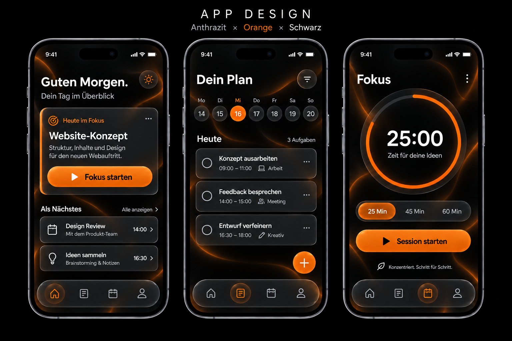

# App-Design: Anthrazit × Orange × Schwarz

Schwarz gibt den drei Screens Tiefe, anthrazitfarbene Glasflächen tragen den Inhalt, und Orange zeigt, was aktiv ist. Manrope bleibt die festgelegte Schriftart.



## Gestaltung

| Designfarbe | Rolle | Beispiel in der Vorlage |
|---|---|---|
| Schwarz `#000000` | Tiefste, ruhige Ebene | Hintergrund hinter den Karten, Zwischenräume und Mitte des Fokustimers |
| Anthrazit `#181A1E` | Oberfläche über Schwarz | Fokuskarte, Aufgabenliste, inaktive Datumsfelder und schwebende Navigation |
| Orange `#FF7A1A` | Aktion und aktiver Zustand | Start-Button, gewählter Tag und Fortschrittsring |

Die abgerundeten Glasflächen behalten ihre feinen Lichtkanten. Sanfte orange Lichtwellen dürfen im Hintergrund durchscheinen. Schwarz ersetzt nicht die Kartenfarbe: Die Trennung von Grund und Oberfläche soll auf allen drei Screens erkennbar bleiben.

**Lesbarkeit:** Haupttext `#F5F5F7` und Sekundärtext `#A7ABB3` stehen auf dunklen Flächen. Auf vollflächigem Orange sind Beschriftungen schwarz (Kontrast 8,05:1). Schwarz und Anthrazit allein unterscheiden sich nur schwach (1,21:1); wichtige Bediengrenzen deshalb mit Kontur oder Form kennzeichnen. Bei transparenten Karten zählt der tatsächlich sichtbare Hintergrund.

## Typografie

[Manrope auf Google Fonts](https://fonts.google.com/specimen/Manrope)

| Einsatz | Gewicht |
|---|---|
| Überschriften und Buttons | Semibold 600 |
| Fließtexte | Regular 400 |
| Beschriftungen und Zahlen | Medium 500 |

Das PNG ist ein generiertes Raster-Mockup mit einer visuellen Annäherung an Manrope. Bei einer App-Umsetzung wird die echte Schriftdatei eingebunden.

## Zugriff von anderen Rechnern

Das Repository ist unter https://github.com/gegmeyermbh/Design von jedem Rechner im Browser erreichbar. Es kann außerdem mit Git geklont werden:

```sh
git clone https://github.com/gegmeyermbh/Design.git
```

