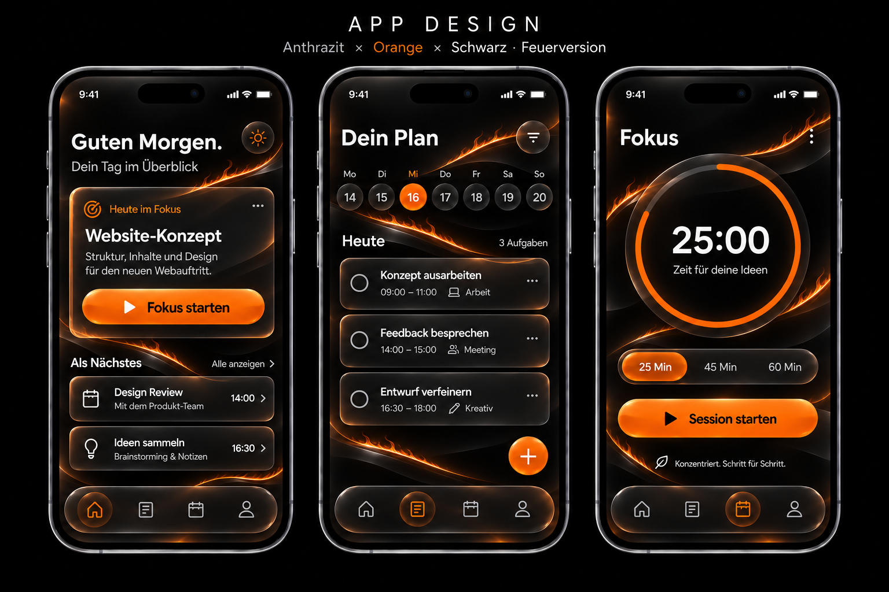

# Feuerversion: Anthrazit × Orange × Schwarz

Die Feuerversion ergänzt die ursprüngliche Gestaltung als eigenständige Alternative. Eine schmale orange Feuerlinie durchzieht den schwarzen Hintergrund; transparente anthrazitfarbene Glasflächen erhalten stärkere Glanzkanten und warme Reflexe. Die neue Variante steht neben der [ursprünglichen Designvorlage](../../README.md).

## Dateien und Downloads

- [App-Design als PNG](app-design-feuerversion.png): drei vollständige Screens mit der bisherigen Anordnung und Manrope-artiger Typografie.
- [Feuerlinie und Glas als Materialreferenz](feuerlinie-glas-referenz.png) sowie [Wallpaper mit aufsteigendem Rauch](feuerlinie-rauch-referenz.png).
- [Chrome-Theme Feuerstrom 1.4.0 herunterladen](downloads/Anthrazit-Orange-Chrome-Feuerstrom-1.4.0.zip), mit [offenen Theme-Dateien und Installationshinweisen](chrome-theme/). Unregelmäßige Feuerströme im Browserrahmen und ein passender Neuer-Tab-Hintergrund verwenden dieselbe Bildsprache; die ursprüngliche anthrazitfarbene Grundstimmung und Theme-Farben bleiben erhalten.
- [Wallpaper-Paar mit Rauch für QHD herunterladen](downloads/Wallpaper-Feuerlinie-QHD.zip), auch als [einzelne PNGs](wallpaper/).
- [Farben und Gestaltung](design-beschreibung.txt) sowie [Bildaufträge](BILDAUFTRAEGE.txt).

## Gestaltung

| Element | Umsetzung |
|---|---|
| Hintergrund | Schwarz #000000 mit ruhigen Freiflächen |
| Glasflächen | Anthrazit #181A1E, optische Transparenz, polierte Kanten und Reflexe |
| Dekoration | Schmale Feuerlinie in Orange #FF7A1A mit kleinen Flammen und kupferfarbenem Licht |
| Primäre Aktionen | Orange mit schwarzer Beschriftung |
| Text | Haupttext #F5F5F7, Sekundärtext #A7ABB3 auf dunklen Flächen |
| Typografie | Manrope: Regular 400, Medium 500, Semibold 600 |

Flammen und Glanz bleiben hinter den Inhalten. Lesbarkeit, klare Bediengrenzen und ausreichend ruhige Flächen haben Vorrang. Die Feuerlinie dient als Dekoration; sie ist kein Statussignal. Der Glaseffekt ist in den PNGs dargestellt, die Bilddateien selbst sind deckend.

Das App-Mockup wurde mit dem integrierten Imagegen-Werkzeug aus der ursprünglichen Referenz und dem neuen Wallpaper-Stil erstellt. Es ist eine visuelle Referenz, keine App-Implementierung. Für eine Umsetzung werden die echten Manrope-Schriftdateien eingebunden. Ein Chrome-Theme verändert Chrome-Farben und Hintergrundbilder; es setzt keine frei wählbare Schriftart für die Browseroberfläche.

Beim Wallpaper steigt sichtbarer Rauch direkt aus den Flammen auf. Das Chrome-Theme verbindet ungleichmäßige, verzweigte Feuerströme im Rahmen mit einem passenden Hintergrund für neue Tabs. Dieser verwendet die ursprünglichen asymmetrischen Randzonen und eine ruhige anthrazitfarbene Mitte. [Texturvorschau](chrome-theme-vorschau.png) und [Bildauftrag](BILDAUFTRAG-CHROME140.txt) dokumentieren die Umsetzung.

## Wallpaper-Aufstellung

Die Einzelbilder sind für zwei QHD-Displays vorbereitet:

- Links: 1440 × 2560 Pixel, Hochformat.
- Rechts: 2560 × 1440 Pixel, Querformat.
- Linke Monitoroberkante 95 mm höher als die rechte; im gemeinsamen Motiv sind dafür 349 Pixel Versatz vorgesehen.
- Zusätzlich wurde das linke Motiv nach Sichtabgleich um 35 Pixel nach unten verschoben.

Die beiden PNGs werden jeweils dem passenden Monitor zugewiesen. Diese Ausschnitte passen zu dieser Aufstellung; bei einer anderen Anordnung wird der Übergang neu zugeschnitten.

## Prüfung

Die Bilddateien wurden dekodiert und visuell geprüft. Die Wallpaper haben die angegebenen Pixelmaße. Das Chrome-Theme hat Chromes eigene Paketprüfung mit Chrome 157.0.8103.40 bestanden; Manifest, Bildverweise, ZIP-Inhalt, ursprüngliche Theme-Farben und das originale Symbol wurden geprüft. Chrome hat das Theme außerdem in einem separaten Testprofil erfolgreich geladen. Die abschließende visuelle Kontrolle im Browser war wegen einer Sperre der Computersteuerung nicht möglich. Details stehen in der Theme-Dokumentation. Das App-Mockup und die Materialreferenz ersetzen keine Prüfung einer späteren App-Umsetzung.
