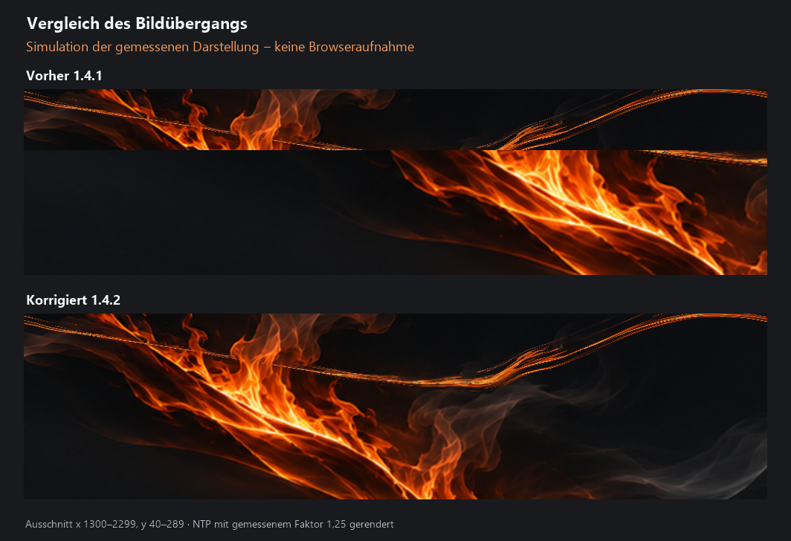

# Chrome-Theme: Feuerstrom als Gesamtmotiv

Version 1.4.2 verwendet weiterhin ein gemeinsames Gesamtmotiv für Tabs, Adressleiste, Lesezeichenleiste und neuen Tab. Kopfzone und Motiv sind unverändert. Die Hintergrunddatei des neuen Tabs gleicht jetzt die aus der bereitgestellten Aufnahme gemessene, abweichende Vergrößerung aus.

[ZIP herunterladen](../downloads/Anthrazit-Orange-Chrome-Feuerstrom-1.4.2.zip) · [Installation](INSTALLATION.txt) · [Manifest](manifest.json)

Die Abbildung zeigt die Mastergrafik, keine Browseraufnahme. Chrome legt seine Bedienelemente darüber.

Der Vergleich simuliert den ausgemessenen Bildmaßstab mit den Artwork-Dateien. Er enthält keine Inhalte der privaten Browseraufnahme.

## Gemeinsame Bildquelle

| Datei | Format und Zuordnung |
|---|---|
| Mastergrafik | 2560 × 1440 Pixel, unverändert |
| Gemeinsame Kopfzone, header.png | Oberste 256 Masterzeilen, 2560 × 256 Pixel, unverändert |
| Neuer Tab, new-tab.png | 2048 × 1042 Pixel, skalierungskorrigierte Abtastung desselben Masters |

Fensterrahmen, inaktiver Rahmen, Tab-Hintergrund und Symbolleiste verwenden dieselbe header.png. Deren Registrierung wurde an den sichtbaren Bildpunkten der bereitgestellten Browseraufnahme bestätigt.

## Gemessene Darstellung und Korrektur

Die Aufnahme zeigt unterschiedliche Maßstäbe:

- Kopfzone: BildschirmX = MasterX; BildschirmY = MasterY − 16.
- Neuer Tab vor der Korrektur: BildschirmX = 1,25 × MasterX; BildschirmY = 1,25 × MasterY − 48,75.

Damit wurde das Bild im neuen Tab um 25 Prozent größer dargestellt als das Bild in den Leisten. Die Ursache muss nicht als Windows-DPI oder Seitenzoom angenommen werden; die Korrektur verwendet den gemessenen Bildmaßstab.

Die neue Hintergrunddatei tastet jedes Ausgabepixel (x, y) bilinear im Master bei (1,25 × x, 137,25 + 1,25 × y) ab. Die erneute 125-Prozent-Darstellung ergibt dadurch geometrisch denselben Maßstab und Bildversatz wie die Kopfzone. Die Ausrichtung bleibt links oben.

Die Anpassung gilt für die ausgemessene QHD-Ansicht mit sichtbarer Lesezeichenleiste und dem relativen NTP-Maßstab 1,25. Bei anderer Skalierung oder anderem Leistenlayout muss der Export neu kalibriert werden. Browser- und Zoom-Einstellungen werden nicht verändert.

## Installation

ZIP vollständig in einen dauerhaften Ordner entpacken. Unter chrome://extensions den Entwicklermodus einschalten, „Entpackte Erweiterung laden“ wählen und den Ordner mit manifest.json auswählen. Diesen Ordner während der Nutzung behalten.

Für die Rückkehr steht das [unveränderte Kupferlicht-Original 1.2.0](../downloads/Anthrazit-Orange-Chrome-Kupferlicht-Original-1.2.0.zip) bereit.

## Prüfung

Die Bildzuordnung wurde anhand der Browseraufnahme numerisch bestimmt. Unabhängige Prüfungen bestätigen den unveränderten Header und die explizite Abtastung des neuen Hintergrunds. Eine Offline-Vorwärtsdarstellung mit dem gemessenen Maßstab ergibt keinen geometrischen Versatz mehr; an feinen Details bleibt normale Resampling-Unschärfe.

Die Prüfungen von Manifest, Bildgrößen, ZIP-Inhalt, ursprünglichen Farbwerten und Originalsymbol sowie Chromes native Paketprüfung sind bestanden. Eine neue visuelle Kontrolle in Chrome ist durch die URL-Erkennung der Computersteuerung blockiert. Die private Browseraufnahme wurde nur lokal ausgewertet und nicht veröffentlicht.

[Prüfbericht](../pruefung-chrome.json) · [Bildauftrag des Feuermaterials](../BILDAUFTRAG-CHROME140.txt)

Quellen: [Gemeinsamer Chrome-Bildzeichner](https://github.com/chromium/chromium/blob/157.0.8103.40/chrome/browser/ui/views/frame/themed_background.cc#L75), [NTP-Hintergrund](https://github.com/chromium/chromium/blob/157.0.8103.40/chrome/browser/resources/new_tab_page/untrusted/background_image.html), [Chrome-Themes](https://developer.chrome.com/docs/extensions/develop/ui/themes).
