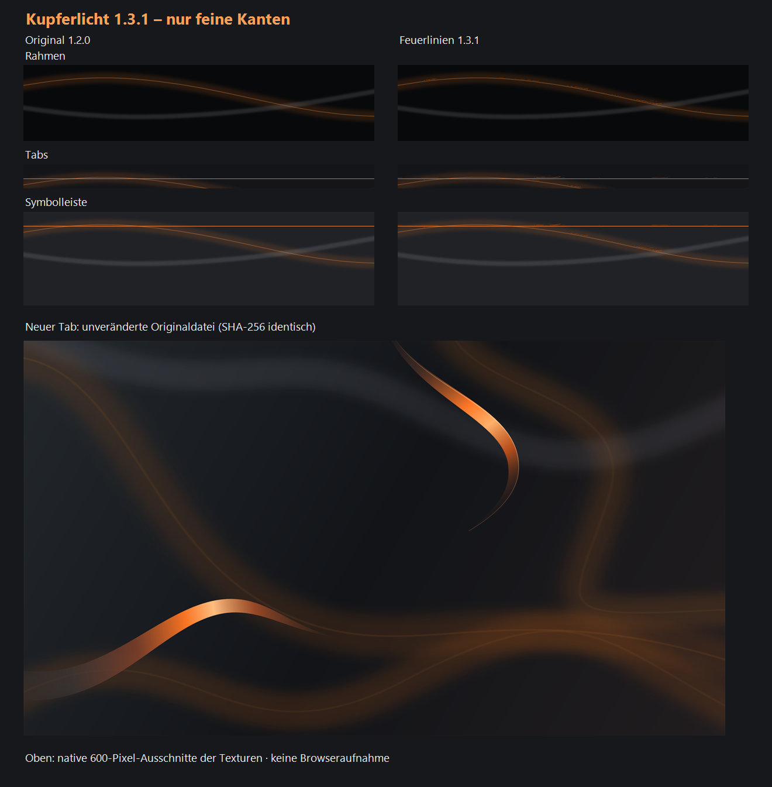

# Chrome-Theme: Kupferlicht mit Feuerlinien

Version 1.3.1 basiert direkt auf dem ursprünglichen Theme „Anthrazit Orange - Kupferlicht“ 1.2.0. Ausschließlich die feinen orangefarbenen Kanten in Fensterrahmen, Tabs und Symbolleiste erhalten kleine Feuerdetails entlang ihrer bisherigen Kurven.

Der Neuer-Tab-Hintergrund und das Theme-Symbol sind bytegleich aus dem Originalpaket übernommen. Alle ursprünglichen Theme-Farben, Hintergrundverweise und Ausrichtungseinstellungen bleiben erhalten. Die vorhandenen grauen Glanzkurven und anthrazitfarbenen Flächen gehören weiterhin zum Original.

[ZIP herunterladen](../downloads/Anthrazit-Orange-Chrome-Feuerlinien-1.3.1.zip) · [Installation](INSTALLATION.txt) · [Manifest](manifest.json)

Zum vollständigen Wiederherstellen ist auch das [unveränderte Original Kupferlicht 1.2.0](../downloads/Anthrazit-Orange-Chrome-Kupferlicht-Original-1.2.0.zip) verfügbar.

## Installation

Das ZIP vollständig in einen dauerhaften Ordner entpacken. In Chrome unter chrome://extensions den Entwicklermodus einschalten, „Entpackte Erweiterung laden“ wählen und den Ordner mit manifest.json auswählen. Den Ordner während der Nutzung behalten. Details und Hinweise zum Aktualisieren bzw. Zurücksetzen stehen in INSTALLATION.txt.

Das Paket ist ein lokales Theme. Es enthält ausschließlich das Manifest und PNG-Bilder sowie die Installationshinweise; keine Skripte, Berechtigungen oder Netzwerkzugriffe.

## Prüfung

- Chromes eigene Paketprüfung über --pack-extension war mit Chrome 157.0.8103.40 erfolgreich.
- Manifest, sämtliche lokalen Bildverweise, PNG-Abmessungen und ZIP-Inhalt wurden geprüft.
- Hintergrund für neue Tabs, Symbol sowie alle Theme-Farben und Eigenschaften stimmen mit Kupferlicht 1.2.0 überein.
- Die drei geänderten Texturen wurden pixelgenau verglichen: Außerhalb schmaler Masken um die bestehenden orangefarbenen Kanten gibt es keine Änderungen; die neutralen grauen Glanzkurven bleiben erhalten.
- Die Vorschau zeigt die tatsächlichen Bildtexturen. Das Theme wurde nicht in einem persönlichen Chrome-Profil installiert; die Darstellung innerhalb Chrome wurde nicht visuell getestet.

| Datei | Pixel |
|---|---|
| Rahmen | 3840 × 256 |
| Inaktive Tabs | 3840 × 41 |
| Symbolleiste | 3840 × 160 |
| Neuer Tab, Original | 3840 × 2160 |
| Theme-Symbol, Original | 128 × 128 |

Glanz und Transparenz sind visuelle Materialeffekte in deckenden Bildern. Die Browserfenster werden dadurch nicht tatsächlich zum Desktop durchsichtig. Chrome bestimmt Schrift, Form der Bedienelemente und den sichtbaren Ausschnitt der Texturen. Eigene Hintergrundbilder für neue Tabs können den Theme-Hintergrund verdecken.

Dokumentation: [Chrome-Themes](https://developer.chrome.com/docs/extensions/develop/ui/themes), [lokales Laden](https://developer.chrome.com/docs/extensions/get-started/tutorial/hello-world#load-unpacked).
