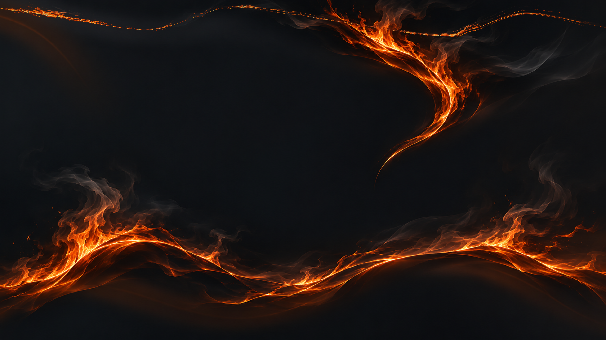

# Chrome-Theme: Feuerstrom als Gesamtmotiv

Version 1.4.1 verwendet ein einziges Gesamtmotiv für die Kopfzone und den neuen Tab. Tabs, Adressleiste und Lesezeichenleiste greifen auf dieselbe Hintergrunddatei zu. Der Neuer-Tab-Hintergrund ist ein passend versetzter Ausschnitt aus derselben Mastergrafik.

[ZIP herunterladen](../downloads/Anthrazit-Orange-Chrome-Feuerstrom-1.4.1.zip) · [Installation](INSTALLATION.txt) · [Manifest](manifest.json)

Die Abbildung ist die reine Mastergrafik, keine Browseraufnahme. Chrome legt seine Tabs, Felder und Schaltflächen darüber.

## Gemeinsame Bildquelle

| Datei | Ausschnitt aus der Mastergrafik |
|---|---|
| Mastergrafik | 2560 × 1440 Pixel |
| Gemeinsame Kopfzone, header.png | Zeilen 0–255, 2560 × 256 Pixel |
| Neuer Tab, new-tab.png | Ab Zeile 136, 2560 × 1304 Pixel |

Die vier Bildverweise für Fensterrahmen, inaktiven Fensterrahmen, Tab-Hintergrund und Symbolleiste zeigen auf dieselbe header.png. Es gibt keine getrennten Grundflächen oder unterschiedlich beginnenden Kurven für diese Bereiche.

Das Feuermotiv durchzieht auch die Quellzeilen für Adress- und Lesezeichenleiste. Die vorherige Beschränkung der Zeichnung auf die obersten Bildzeilen entfällt.

## Zielansicht

Die Registrierung ist für die QHD-Ansicht mit 2560 × 1440 Pixeln, Standarddarstellung bei 100 Prozent und sichtbarer Lesezeichenleiste ausgelegt. Für die Kopfzone werden 120 DIP angesetzt. Mit dem gemeinsamen Chrome-Bildursprung von 16 DIP darüber beginnt der Ausschnitt für den neuen Tab bei Masterzeile 136. Die Ausrichtung des neuen Tabs ist deshalb links oben.

Bei anderer UI-Dichte oder ausgeblendeter Lesezeichenleiste muss der Körperausschnitt angepasst werden. Das Motiv wird innerhalb der PNGs nicht dynamisch an wechselnde Leistenhöhen angepasst.

## Installation

ZIP vollständig in einen dauerhaften Ordner entpacken. Unter chrome://extensions den Entwicklermodus einschalten, „Entpackte Erweiterung laden“ wählen und den Ordner mit manifest.json auswählen. Diesen Ordner während der Nutzung behalten.

Für eine vollständige Rückkehr steht das [unveränderte Kupferlicht-Original 1.2.0](../downloads/Anthrazit-Orange-Chrome-Kupferlicht-Original-1.2.0.zip) bereit.

## Prüfung

Die drei aktiven UI-Bildverweise und der inaktive Rahmen wurden auf dieselbe Datei geprüft. Kopfzone und Neuer-Tab-Ausschnitt werden pixelgenau mit der Mastergrafik verglichen. Manifest, Bildgrößen, ZIP-Inhalt sowie die ursprünglichen Farbwerte und das Originalsymbol werden geprüft; dazu kommt Chromes native Paketprüfung.

Eine abschließende visuelle Kontrolle in Chrome ist durch die URL-Erkennung der Computersteuerung blockiert. Die Registrierung basiert auf dem gemeinsamen Bildzeichner von Chrome 157 und den genannten Zielmaßen. Das persönliche Chrome-Profil wurde nicht verändert.

[Prüfbericht](../pruefung-chrome.json) · [Bildauftrag für das Feuermaterial](../BILDAUFTRAG-CHROME140.txt)

Quellen: [Gemeinsamer Chrome-Bildzeichner](https://github.com/chromium/chromium/blob/157.0.8103.40/chrome/browser/ui/views/frame/themed_background.cc#L75), [Tab-Hintergrund](https://github.com/chromium/chromium/blob/157.0.8103.40/chrome/browser/ui/views/tabs/common/horizontal_tab_style_views.cc#L798), [Chrome-Themes](https://developer.chrome.com/docs/extensions/develop/ui/themes).
